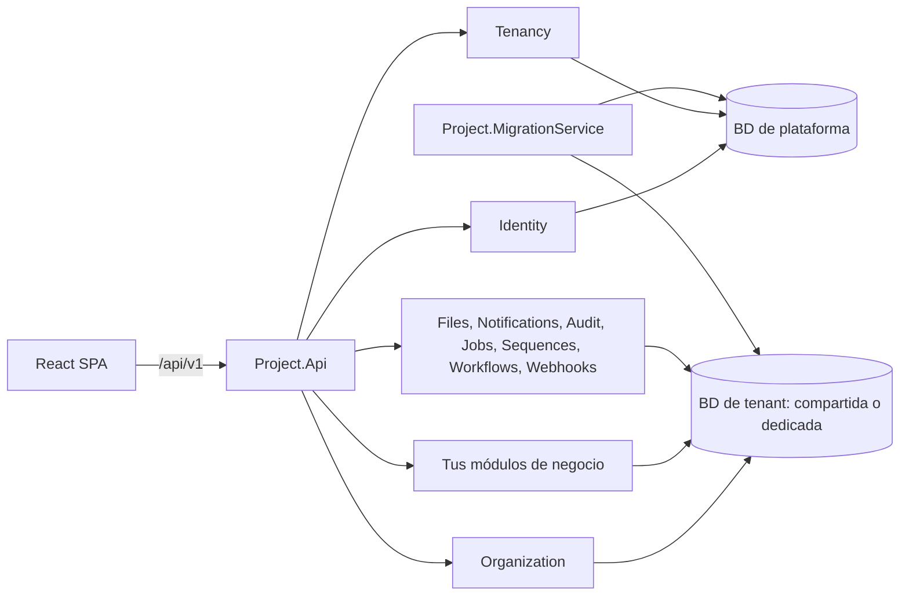

<div align="center">

# Plantilla .NET + React

Base empresarial modular en .NET 10 y React 19 para construir desde aplicaciones pequeñas hasta CRM, ERP y SaaS
multi-tenant con los mismos patrones, la misma seguridad y despliegue en cualquier plataforma.

[Documentación](docs/README.md) ·
[Inicio rápido](docs/02-inicio-rapido.md) ·
[Arquitectura](docs/05-arquitectura.md) ·
[Despliegue](docs/despliegue/00-estrategias.md) ·
[Contribuir](CONTRIBUTING.md) ·
[Changelog](CHANGELOG.md)

[](https://github.com/DannyGalvan/Plantilla_NET_React_TypeScript/actions/workflows/ci.yml)
[](LICENSE)
[](https://dotnet.microsoft.com/)
[](https://react.dev/)
[](https://www.typescriptlang.org/)
[](https://tailwindcss.com/)

[](docs/guias/acceso-a-datos.md)
[](docs/guias/acceso-a-datos.md)
[](docs/guias/acceso-a-datos.md)
[](docs/despliegue/docker.md)

</div>

## Tabla de contenidos

- [Acerca del proyecto](#acerca-del-proyecto)
- [Características](#características)
- [Stack tecnológico](#stack-tecnológico)
- [Arquitectura](#arquitectura)
- [Inicio rápido](#inicio-rápido)
- [Estructura del repositorio](#estructura-del-repositorio)
- [Uso](#uso)
- [Despliegue](#despliegue)
- [Documentación](#documentación)
- [Contribuir](#contribuir)
- [Licencia](#licencia)

## Acerca del proyecto

La plantilla resuelve el arranque de cualquier aplicación de negocio: autenticación, permisos, multi-tenancy,
estructura organizativa, acceso a datos multi-motor, theming por marca, i18n, observabilidad, pruebas y despliegue.
No impone un dominio. Trae las capacidades que casi toda aplicación necesita (archivos, notificaciones, historial,
tareas programadas, numeración, aprobaciones, importar/exportar y webhooks), así que sirve igual para un CRM, un ERP,
nómina, RRHH, una bolsa de empleo, un e-commerce, delivery o finanzas. Cada funcionalidad se agrega como un **módulo**
independiente, sin editar el código existente.

Principios: SOLID (en especial responsabilidad única y abierto/cerrado), módulos que solo se comunican por contratos,
seguro por defecto (fail-closed), todo configurable y sin costo por lo que no se usa.

## Características

| Área | Capacidad |
|---|---|
| Arquitectura | Monolito modular con Clean Architecture por módulo, CQRS con Mediator, reglas verificadas con pruebas de arquitectura |
| CRUD genérico | Un recurso completo (listar, filtrar, ordenar, paginar, crear, actualizar, JSON Merge Patch, borrado lógico, restaurar) con un mapper, una política y un validador |
| Datos | EF Core 10 en PostgreSQL, SQL Server y MySQL; Dapper, ADO.NET y procedimientos almacenados para rutas de alto rendimiento; migraciones por motor |
| Multi-tenancy | `None`, `SharedDatabase`, `DatabasePerTenant` o `Hybrid` solo por configuración; resolución por dominio, subdominio o token |
| Organización | Empresas, países, marcas y sucursales con filtrado automático de datos por unidad |
| Seguridad | JWT corto + refresh token rotativo con detección de reuso, CSRF, lockout, historial de contraseñas, permisos en servidor con caché híbrida y endpoints fail-closed |
| Configuración | Settings en cascada (sistema, tenant, unidad, usuario) y feature flags por tenant |
| Archivos | Adjuntos con los permisos del registro; almacenamiento por tenant en disco, S3, Azure Blob, Google Drive u OneDrive |
| Procesos | Notificaciones in-app y email con plantillas por tenant, flujos de aprobación por permiso, rol o monto, tareas programadas por tenant |
| Datos de negocio | Historial de cambios automático, numeración de documentos por tenant y unidad, `Money`, importar y exportar CSV o Excel |
| Integración | Webhooks firmados con HMAC, reintentos y protección SSRF; outbox con entrega idempotente |
| Operación | Configuración de la plataforma en la base de datos, editable en tiempo de ejecución sin volver a desplegar; secretos cifrados con una master key |
| Frontend | React 19, módulos por manifiesto, tokens OKLCH, presets de marca, modo oscuro, densidad, personalizador de tema, i18n es/en |
| Observabilidad | Serilog estructurado, OpenTelemetry (trazas, métricas, logs), health checks de liveness y readiness |
| Pruebas | Unitarias, de arquitectura, funcionales con Testcontainers en los 3 motores y aislamiento entre tenants y unidades |
| Despliegue | Docker, Linux con systemd + nginx, IIS, y worker de migraciones independiente |

## Stack tecnológico

| Capa | Tecnologías |
|---|---|
| Backend | .NET 10, ASP.NET Core Minimal APIs, Mediator, FluentValidation, Mapperly |
| Datos | EF Core 10, Npgsql, SqlClient, MySql.EntityFrameworkCore, Dapper |
| Infraestructura | HybridCache + Redis opcional, Serilog, OpenTelemetry, Scalar (OpenAPI) |
| Frontend | React 19, Vite 7, TypeScript 5, React Router 7, TanStack Query y Table, React Hook Form, Zod 4, Zustand, Radix, Tailwind CSS 4, i18next |
| Pruebas | xUnit v3, Shouldly, NSubstitute, NetArchTest, Testcontainers, Vitest, Testing Library, MSW |

Detalle y licencias en [docs/08-tecnologias.md](docs/08-tecnologias.md).

## Arquitectura



Cada módulo tiene cuatro proyectos (`Domain`, `Application`, `Infrastructure`, `Contracts`) y solo se comunica con
otros módulos por sus `Contracts`. Detalle en [docs/05-arquitectura.md](docs/05-arquitectura.md).

## Inicio rápido

Requisitos: .NET SDK 10, Node 24 con pnpm (`corepack enable`) y Docker. Ver [requisitos por sistema operativo](docs/01-prerequisitos.md).

```bash
git clone https://github.com/DannyGalvan/Plantilla_NET_React_TypeScript.git
cd Plantilla_NET_React_TypeScript
docker compose --profile postgres up -d
./scripts/setup.sh --non-interactive
dotnet run --project src/Host/Project.Api
```

```powershell
git clone https://github.com/DannyGalvan/Plantilla_NET_React_TypeScript.git
cd Plantilla_NET_React_TypeScript
docker compose --profile postgres up -d
./scripts/setup.ps1 -NonInteractive
dotnet run --project src/Host/Project.Api
```

Abre `https://localhost:7180` e inicia sesión con `admin` y la contraseña que imprimió `setup` (se pide cambiarla).
Otras formas de ejecución (solo Docker, nativo, base local) en [docs/02-inicio-rapido.md](docs/02-inicio-rapido.md).

## Estructura del repositorio

```
src/
  BuildingBlocks/     SharedKernel, Application, Infrastructure, Web (plataforma reutilizable)
  Modules/            Plataforma (Tenancy, Identity, Organization), capacidades (Files, Notifications, Audit, Jobs,
                      Sequences, Workflows, Webhooks) y el ejemplo opcional Catalog; cada uno con 4 proyectos
  Migrations/         Migraciones EF Core por motor: SqlServer, PostgreSql, MySql
  Host/               Project.Api, Project.MigrationService, Project.Composition, Project.ServiceDefaults
  project.client/     SPA React (src/app, src/shared, src/modules)
tests/                UnitTests, ArchitectureTests, Api.FunctionalTests
deploy/               docker, linux, iis
scripts/              setup, doctor, add-migration, new-module, remove-module, check-docs
docs/                 guías, despliegue y ADRs
```

## Uso

```bash
node scripts/new-module.mjs Inventory Warehouse   # módulo full-stack con CRUD (backend + frontend)
node scripts/remove-module.mjs Catalog            # quita el ejemplo cuando tengas tus módulos
./scripts/add-migration.sh Inventory Initial       # migración en los 3 motores
dotnet test Project.slnx                           # pruebas backend (requiere Docker)
cd src/project.client && pnpm verify               # pruebas y calidad del frontend
```

Guías: [crear una aplicación](docs/06-crear-una-aplicacion.md), [agregar un módulo](docs/07-agregar-un-modulo.md) y
[capacidades transversales](docs/guias/capacidades-transversales.md).

## Despliegue

| Destino | Guía |
|---|---|
| Docker / Docker Compose | [docs/despliegue/docker.md](docs/despliegue/docker.md) |
| Linux (systemd + nginx) | [docs/despliegue/linux-systemd-nginx.md](docs/despliegue/linux-systemd-nginx.md) |
| Windows Server (IIS) | [docs/despliegue/iis-windows-server.md](docs/despliegue/iis-windows-server.md) |
| Migraciones en producción | [docs/despliegue/migraciones-en-produccion.md](docs/despliegue/migraciones-en-produccion.md) |

## Documentación

| Quiero... | Documento |
|---|---|
| Entender qué resuelve la plantilla | [00-objetivo-y-alcance](docs/00-objetivo-y-alcance.md) |
| Instalar lo necesario | [01-prerequisitos](docs/01-prerequisitos.md) |
| Configurar un proyecto nuevo | [03-configuracion-inicial](docs/03-configuracion-inicial.md) |
| Elegir el modo multi-tenant | [guias/multitenancy](docs/guias/multitenancy.md) |
| Ver todo el índice | [docs/README.md](docs/README.md) |

## Contribuir

Lee [CONTRIBUTING.md](CONTRIBUTING.md), el [código de conducta](CODE_OF_CONDUCT.md) y la [política de seguridad](SECURITY.md).

## Licencia

Distribuido bajo la licencia MIT. Ver [LICENSE](LICENSE).
