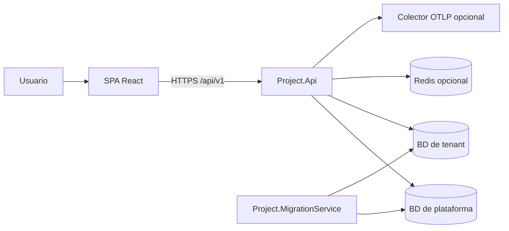
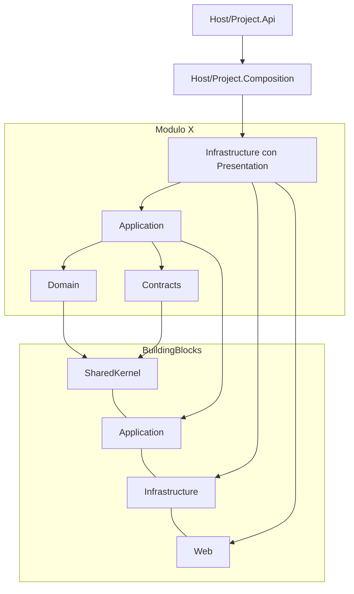
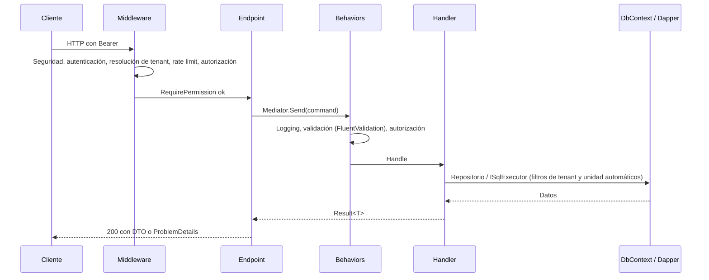

# Arquitectura

**Para qué sirve este documento:** entender cómo está organizado el código, por qué, y dónde extenderlo.

## Contexto

## Capas y reglas de dependencia

| Proyecto | Puede depender de | Contiene |
|---|---|---|
| `Project.SharedKernel` | nada | `Entity`, `AggregateRoot`, `Result`, `Error`, marcadores (`IMultiTenant`, `ISoftDeletable`...) |
| `Project.Application` | SharedKernel | Abstracciones (repositorio, unidad de trabajo, SQL, caché, tenancy, settings, permisos), CQRS, behaviors, CRUD genérico, parser de consultas |
| `Project.Infrastructure` | Application | EF Core multi-motor, filtros globales, pipeline de guardado, Dapper, outbox, tenancy, migrador |
| `Project.Web` | Application, Infrastructure | `IModule`, `MapCrud`, permisos, ProblemDetails, seguridad HTTP, OpenAPI |
| `Modulo.Domain` | SharedKernel | Entidades y eventos del módulo |
| `Modulo.Contracts` | SharedKernel | Permisos e interfaces públicas para otros módulos |
| `Modulo.Application` | Domain, Contracts propios y de otros módulos, Project.Application | Casos de uso, DTOs, validadores, mapeos, políticas de consulta |
| `Modulo.Infrastructure` | Application, Project.Infrastructure, Project.Web | DbContext, configuraciones EF, servicios, endpoints (`Presentation`), clase `XModule` |

Estas reglas las verifica `tests/Project.ArchitectureTests` (por ejemplo, ningún `Application` referencia EF Core ni
ASP.NET Core y ningún módulo referencia el interior de otro).

## Flujo de una petición

## Patrones usados

| Patrón | Dónde |
|---|---|
| CQRS + Mediator | `Project.Application/Messaging`, handlers de cada módulo |
| Pipeline / Decorator | `LoggingBehavior`, `ValidationBehavior`, `AuthorizationBehavior`; `ISaveChangesStep` en el guardado |
| Repository + Unit of Work + Specification | `IRepository<T,TId>`, `IUnitOfWork`, `Specification<T>`, `EfRepository` |
| Strategy | `IDatabaseProvider` (motores), `IFilterOperator` (operadores del filtro), `ITenantResolver` |
| Result | `Result`, `Result<T>`, `Error` mapeados a ProblemDetails |
| Outbox | `OutboxStep` guarda eventos en la misma transacción; `OutboxProcessor` los publica |
| Options | Secciones de configuración validadas al iniciar (`ValidateOnStart`) |
| Modular monolith | `IModule` + `AppModules` |

## Decisiones

Ver los [ADR](adr). Resumen: monolito modular (0001), Mediator con generador (0002), Minimal APIs con prefijo de versión
(0003), Guid v7 (0004), shadcn/Radix con tokens OKLCH (0005), modos de tenancy (0006), permisos en servidor con caché
(0007), Mapperly (0008), persistencia multi-motor (0009), estrategia de pruebas (0010).

## Analizadores

`Directory.Build.props` activa `TreatWarningsAsErrors` y el nivel `latest-recommended` de los analizadores .NET. Las
reglas desactivadas están en su lista `NoWarn`.
