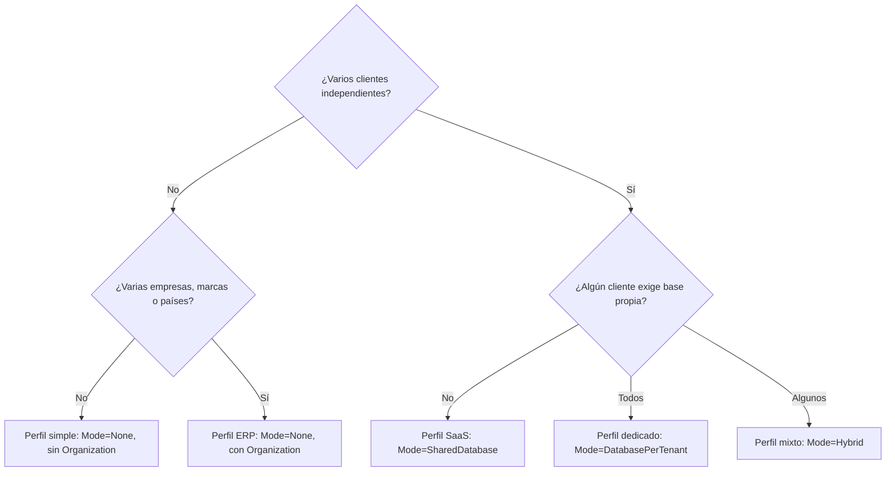

# Crear una aplicación a partir de la plantilla

**Para qué sirve este documento:** decidir la topología, preparar la base para tu dominio y aplicar la receta del tipo
de aplicación que vas a construir (CRM, ERP, nómina, RRHH, bolsa de empleo, e-commerce, delivery, finanzas u otra).
**Requisitos previos:** [02 Inicio rápido](02-inicio-rapido.md).
**Tiempo estimado:** 30 minutos.

## Qué trae la base y qué agregas tú

La plantilla no impone un dominio. Trae:

- **Plataforma**: `Tenancy`, `Identity` y, opcional, `Organization` (empresas, marcas, países, sucursales).
- **Capacidades transversales**: archivos, notificaciones, historial de cambios, tareas programadas, numeración,
  aprobaciones, importar/exportar y webhooks. Ver [Capacidades transversales](guias/capacidades-transversales.md).
- **Un ejemplo opcional**: `Catalog` (productos, categorías, reporte de inventario). Solo se carga con
  `Modules:Enabled: ["Catalog"]`; está activo en Development como referencia.

Tu aplicación son tus módulos de negocio, generados con `new-module` y construidos sobre esas capacidades.

## Árbol de decisión



## Pasos comunes

1. Crea un repositorio desde la plantilla (`Use this template` en GitHub).
2. Configura según el perfil (abajo) y ejecuta `./scripts/setup.sh` o `./scripts/setup.ps1`.
3. Desactiva las capacidades que no necesites con `Modules:Disabled` (por ejemplo `["Webhooks", "Sequences"]`).
4. Genera tus módulos:

```bash
node scripts/new-module.mjs Hr Employee --org-scoped
./scripts/add-migration.sh Hr Initial
```

```powershell
node scripts/new-module.mjs Hr Employee --org-scoped
./scripts/add-migration.ps1 -Module Hr -Name Initial
```

5. Cuando ya no necesites el ejemplo, bórralo por completo: backend, migraciones, registro y front.

```bash
node scripts/remove-module.mjs Catalog
```

El script lista las pruebas y documentos que aún lo mencionan. Las pruebas de aislamiento de la plantilla usan
`Catalog`: adáptalas a una entidad de tu dominio antes de borrarlo.

## Recetas por tipo de aplicación

Cada receta indica el perfil, los módulos de negocio a generar y qué capacidad resuelve cada necesidad. Los nombres son
sugerencias.

| Aplicación | Perfil | Módulos de negocio | Capacidades que usa |
|---|---|---|---|
| CRM | ERP o SaaS | `Customers`, `Leads`, `Opportunities`, `Activities` | Adjuntos en clientes, notificaciones de seguimiento, tareas de recordatorio, importar clientes, webhooks `crm.lead.converted` |
| ERP | ERP | `Purchasing`, `Sales`, `Inventory`, `Accounting` | Numeración de facturas y órdenes por sucursal, aprobación de compras por monto, `Money`, historial, exportar a Excel |
| Nómina | ERP | `Payroll`, `Employees` | Tarea mensual de cierre, numeración de recibos, PDF del recibo con `IFileService`, aprobación de la planilla, `Money` |
| Flujos de RRHH | ERP | `Employees`, `Leaves`, `Expenses` | Aprobaciones de vacaciones y gastos, notificaciones, adjuntos (comprobantes), historial |
| Bolsa de empleo | SaaS | `Jobs`, `Candidates`, `Applications` | CV como adjunto (Drive u OneDrive del cliente), notificaciones a candidatos, webhooks a ATS externos, exportar postulaciones |
| E-commerce | Simple o SaaS | `Catalog` (base del ejemplo), `Orders`, `Customers` | Fotos de producto, numeración de pedidos, `Money`, webhooks `sales.order.paid` para logística, importar catálogo |
| Delivery | SaaS | `Orders`, `Drivers`, `Zones` | Notificaciones de estado, tareas para reasignar pedidos vencidos, webhooks a la app del repartidor, sucursales como unidades |
| Finanzas personales o empresariales | Simple o ERP | `Accounts`, `Transactions`, `Budgets` | `Money` con moneda por unidad, importar extractos CSV, tareas de conciliación, aprobación de pagos |

### Ejemplo completo: solicitud de vacaciones (RRHH)

1. `node scripts/new-module.mjs Hr LeaveRequest --org-scoped` genera la entidad y su CRUD.
2. En `HrModule.AddServices` declara lo que usa:

```csharp
services.AddWorkflow(new("hr.leave", "hr", "Vacaciones",
[
    new("Jefe inmediato", ApproverKind.Permission, "hr.leave.approve"),
    new("Recursos humanos", ApproverKind.Role, "HR", MinAmount: 10), // 10 días o más
]));
services.AddSequence(new("hr.leave", "VAC-{yyyy}-{0000}", SequenceReset.Yearly));
services.AddAttachmentTarget<LeaveRequest>("hr.leaveRequest", HrPermissions.LeaveRequests.Read, HrPermissions.LeaveRequests.Update);
services.AddWebhookEvent<LeaveApproved>("hr.leave.approved");
```

3. Al crear la solicitud, asígnale su número con `ISequenceGenerator` y envíala con `IApprovalService.SubmitAsync`,
   usando los días como `Amount`.
4. Maneja `ApprovalCompletedEvent` (filtrando `Workflow == "hr.leave"`) para marcarla como aprobada o rechazada y
   levantar `LeaveApproved`.
5. En el front, agrega `<Attachments>` y `<HistoryPanel>` al detalle, y `<DataExchange>` al listado.

No hace falta crear tablas de aprobaciones, notificaciones, archivos ni historial: las aporta la plataforma, filtradas
por tenant y unidad.

## Configuración por perfil

### Simple

```json
{ "Tenancy": { "Mode": "None" }, "Modules": { "Disabled": ["Organization"] } }
```

### ERP o grupo empresarial

```json
{ "Tenancy": { "Mode": "None" } }
```

Crea la jerarquía (empresa, país, marca, sucursal) en *Organización* y asigna usuarios a sus unidades. Genera los
módulos con `--org-scoped` para que cada registro pertenezca a una unidad.

### SaaS

```json
{ "Tenancy": { "Mode": "SharedDatabase", "RootDomain": "miapp.com", "Resolvers": ["Host", "Subdomain", "Claim"] } }
```

1. Inicia sesión como `admin` (administrador de plataforma) y crea cada cliente en *Tenants* con su dominio
   (`acme.miapp.com`). Luego pulsa *Aprovisionar*, que crea sus roles y datos iniciales.
2. Crea los usuarios de cada cliente entrando por su dominio.
3. Define la marca de cada cliente en *Configuración > Marca* (nivel Organización). El mismo build muestra marcas
   distintas por dominio.
4. Cada cliente conecta su almacenamiento (Google Drive, OneDrive, S3) en *Almacenamiento*. Ver
   [Archivos y almacenamiento](guias/archivos-y-almacenamiento.md).
5. Para un cliente con base dedicada:
   - Usa `Mode=Hybrid` y crea el tenant con aislamiento `Dedicated`, su motor y una referencia de secreto
     (`ConnectionSecretRef`).
   - Guarda la cadena de conexión real en `Secrets:<referencia>` (variable de entorno `Secrets__<referencia>` o un
     almacén de secretos).
   - Pulsa *Aprovisionar*.

## Quitar lo que no usas

| Quiero quitar | Cómo |
|---|---|
| Empresas y marcas | `Modules:Disabled: ["Organization"]` |
| Una capacidad (por ejemplo webhooks) | `Modules:Disabled: ["Webhooks"]`; los módulos de negocio siguen funcionando (NoOp) |
| El ejemplo `Catalog` | `node scripts/remove-module.mjs Catalog` |
| Inglés | Quitar `en` de `supportedLanguages` en `src/shared/i18n/index.ts` y de `languages` en `/platform/config` |
| Administración de tenants en la UI | Dejar `Features:platform.admin=false` |

## Cómo verificar que funcionó

- `dotnet test Project.slnx` y `pnpm verify` en verde después de generar tus módulos.
- El menú muestra tus módulos y las capacidades activas; las desactivadas no aparecen.

## Problemas comunes

Ver [troubleshooting.md](troubleshooting.md).
