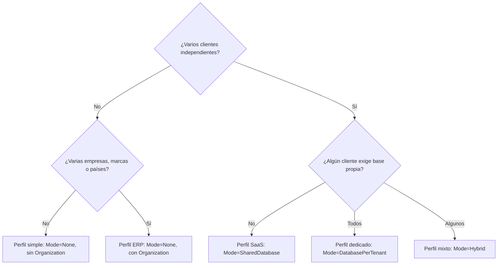

# Crear una aplicación a partir de la plantilla

**Para qué sirve este documento:** decidir la topología y arrancar una aplicación nueva con tres recetas.
**Tiempo estimado:** 30 minutos.

## Árbol de decisión



## Pasos comunes

1. Clona o crea un repositorio desde la plantilla (`Use this template` en GitHub).
2. Configura según el perfil (abajo) y ejecuta `./scripts/setup.sh` o `./scripts/setup.ps1`.
3. Elimina el módulo de ejemplo `Catalog` cuando tengas el tuyo: quita su línea de `AppModules.cs`, sus proyectos de
   `Project.slnx`, su referencia en `Project.Composition` y en los proyectos de migraciones (incluidas sus factorías y
   carpetas `Catalog/`), y la carpeta `src/project.client/src/modules/catalog`.

## Receta A: inventario pequeño (perfil simple)

```json
{ "Tenancy": { "Mode": "None" }, "Modules": { "Disabled": ["Organization"] } }
```

```bash
node scripts/new-module.mjs Inventory Warehouse
./scripts/add-migration.sh Inventory Initial
```

Agrega las entidades restantes (`Item`, `StockMovement`) siguiendo [07-agregar-un-modulo.md](07-agregar-un-modulo.md).

## Receta B: CRM de un grupo empresarial (perfil ERP)

```json
{ "Tenancy": { "Mode": "None" } }
```

- Módulos `Customers`, `Leads`, `Opportunities` y `Activities` generados con `new-module`, con `--org-scoped` para que
  cada registro pertenezca a una empresa o marca.
- Comunicación entre módulos por contratos: `Leads` publica un evento de dominio `LeadConverted`; `Customers` lo maneja
  con un `IDomainEventHandler<LeadConverted>` declarado en su `Application`. El evento se define en `Leads.Contracts`
  para que `Customers` no dependa del interior de `Leads`.
- Crea la jerarquía (empresa, país, marca) en *Organización* y asigna usuarios a sus unidades.

## Receta C: SaaS (perfil SaaS)

```json
{ "Tenancy": { "Mode": "SharedDatabase", "RootDomain": "miapp.com", "Resolvers": ["Host", "Subdomain", "Claim"] } }
```

1. Inicia sesión como `admin` (administrador de plataforma) y crea cada cliente en *Tenants* con su dominio
   (`acme.miapp.com`) y luego *Aprovisionar*, que crea sus roles y datos iniciales.
2. Crea los usuarios de cada cliente entrando por su dominio.
3. Define la marca de cada cliente en *Configuración > Marca* (nivel Organización); el mismo build muestra marcas distintas por dominio.
4. Para un cliente con base dedicada usa `Mode=Hybrid`, crea el tenant con aislamiento `Dedicated`, motor y una
   referencia de secreto (`ConnectionSecretRef`); guarda la cadena real en `Secrets:<referencia>` (variable de entorno
   `Secrets__<referencia>` o un almacén de secretos) y pulsa *Aprovisionar*.

## Quitar lo que no usas

| Quiero quitar | Cómo |
|---|---|
| Empresas y marcas | `Modules:Disabled: ["Organization"]` (o quitar la línea de `AppModules`) |
| Inglés | Quitar `en` de `supportedLanguages` en `src/shared/i18n/index.ts` y de `languages` en `/platform/config` |
| Administración de tenants en la UI | Dejar `Features:platform.admin=false` |
